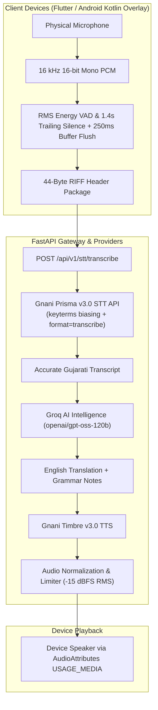

# LingoBoop — Audio Pipeline Audit & Architecture

## 1. System Pipeline Overview

---

## 2. Audio Capture Specifications

| Parameter | Specification | Purpose |
|---|---|---|
| Sample Rate | 16,000 Hz | Optimal for Gnani Prisma STT acoustic models |
| Channels | 1 (Mono) | Minimizes bandwidth and conforms to telephony/speech standards |
| Bit Depth | 16-bit Linear PCM | Provides 96 dB dynamic range |
| Silence Threshold | -42.0 dBFS | Accurately distinguishes background noise from soft vocalizations |
| Trailing Silence Timeout | 1,400 ms (1.4s) | Allows speakers to pause naturally between clauses |
| Post-Silence Buffer Flush | 250 ms | Prevents clipping sentence-final consonants ("છે", "છું") |
| Maximum Utterance Limit | 30.0 s | Matches upstream REST payload boundaries |

---

## 3. Speech-to-Text Architecture

- **Endpoint:** `POST https://api.vachana.ai/stt/v3`
- **Model:** `prisma-v3.0`
- **Headers:** `X-API-Key-ID: <GNANI_API_KEY>`
- **Payload:** `multipart/form-data` with `audio_file`, `language_code`, `model`, `format`, `keyterms`.
- **Segmentation Strategy:** For utterances exceeding 26 seconds, the backend segments the audio at low-energy minima with 0.8-second overlap windows and merges transcripts chronologically without duplication.

---

## 4. Text-to-Speech & Loudness Normalization

- **Engine:** Gnani Timbre v3.0
- **Normalization Strategy:** Peak-normalized and limited via soft-knee tanh compression targeting -15 dBFS RMS and -1.0 dBFS true peak.
- **Playback Routing:**
  - `AudioAttributes.USAGE_MEDIA`
  - `AudioAttributes.CONTENT_TYPE_SPEECH`
  - Stream volume linked to hardware media stream.
